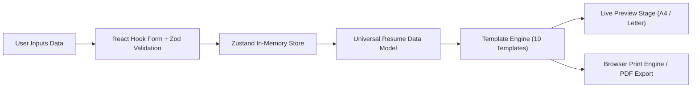

# Architecture Specification

## 1. System Overview
The Professional Resume & CV Generator is an online-only, client-side web application built with Next.js (App Router), TypeScript, Tailwind CSS, shadcn/ui, and Zustand.

The core principle is **zero-retention, privacy-first client-side document authoring**:
- No user accounts or authentication.
- No remote database or cloud persistence.
- No AI APIs or paid third-party dependencies.
- No offline caching or service worker persistence.
- High-fidelity PDF generation via browser-native print standards and vector-accurate rendering.

---

## 2. Feature-Oriented Directory Architecture

The project strictly follows the feature-oriented structure outlined in `AGENTS.md`:

```text
cvmaker/
├── app/                        # Next.js App Router routes and pages
│   ├── layout.tsx              # Root HTML/body shell and global font/theme providers
│   ├── page.tsx                # Public homepage with hero, features, FAQ, CTA
│   ├── builder/                # Interactive resume builder & live preview workspace
│   │   └── page.tsx
│   ├── templates/              # Public template gallery and showcase
│   │   └── page.tsx
│   ├── privacy/                # Privacy policy (essential for AdSense & compliance)
│   ├── terms/                  # Terms of service
│   ├── about/                  # About page
│   ├── contact/                # Contact information
│   ├── sitemap.ts              # Dynamic sitemap generator
│   └── robots.ts               # Robots.txt generator
├── components/                 # Shared UI components
│   ├── ui/                     # Primitives (shadcn/ui based on Radix / Tailwind)
│   ├── layout/                 # Global header, footer, navigation bars
│   └── ads/                    # Isolated AdSense placeholder slots (policy-compliant)
├── features/                   # Core business logic domains
│   ├── templates/              # Template catalog, template registry, metadata
│   │   ├── registry.ts         # Index of the 10 professional resume templates
│   │   └── types.ts            # Template definition and configuration contracts
│   ├── resume-editor/          # Dynamic form sections (React Hook Form + Zod)
│   │   ├── components/         # Section form editors (Experience, Education, Skills, etc.)
│   │   └── hooks/              # Section management and form sync hooks
│   ├── resume-preview/         # Live preview stage, zoom, page simulation, pagination
│   │   ├── components/         # Preview viewport, zoom controls, paper container
│   │   └── hooks/              # Zoom, dimension tracking, page break estimation
│   ├── pdf-export/             # PDF generation utilities, print stylesheets, triggers
│   │   ├── components/         # Print container wrapper
│   │   └── utils/              # Print trigger and print CSS rules
│   └── internationalization/   # Multilingual & RTL typography support
│       ├── config.ts           # Supported locales: EN, UR, AR, FR, ES
│       ├── dictionaries/       # Interface strings
│       └── utils/              # RTL text direction helpers and typography mappers
├── hooks/                      # Generic cross-cutting React hooks
├── lib/                        # Utility functions, helpers, class merging
├── schemas/                    # Zod validation schemas for resume data model
├── stores/                     # Zustand stores for in-memory resume data & UI settings
├── styles/                     # Global styles, Tailwind base, and print media rules
├── types/                      # Universal TypeScript types and data models
├── public/                     # Static assets, fonts, template preview thumbnails
├── tests/                      # Automated tests (unit, form validation, template rendering)
└── docs/                       # Project architecture, design, and progress documentation
```

---

## 3. Data Flow and State Management



### Key Principles:
1. **Universal Data Model**:
   - Resume content is independent of the selected template.
   - Switching templates instantly re-renders the document without modifying, dropping, or reformatting user content.
2. **In-Memory Volatility**:
   - Data exists strictly in the browser runtime (Zustand state).
   - If the user reloads or navigates away, a window `beforeunload` warning alerts them of unsaved work.
3. **Separation of Presentation & Content**:
   - Presentation settings (color scheme, typography, spacing, section visibility, section ordering) are stored in a dedicated `designConfig` slice.
   - Content entries (experience, education, skills, projects, certifications, etc.) are stored in a `resumeData` slice with stable UUIDs.

---

## 4. Universal Resume Data Structure

The schema defines validated types for:
- **Personal Details**: Full name, headline, summary, avatar/photo (in-memory data URL).
- **Contact Details**: Email, phone, location/city/country, website, LinkedIn, GitHub, social links.
- **Repeatable Sections with Stable IDs**:
  - `WorkExperience[]`
  - `Education[]`
  - `Skills[]` (categorized or leveled)
  - `Projects[]`
  - `Certifications[]`
  - `Languages[]`
  - `Awards[]`
  - `Volunteering[]`
  - `CustomSections[]`
- **Design Configuration**:
  - `templateId`: Current active template identifier.
  - `paperSize`: `'a4' | 'letter'`.
  - `primaryColor`: Accent palette.
  - `fontFamily`: Curated typography system.
  - `fontSize`: Standard scale (`sm | md | lg`).
  - `spacing`: Line height and margin density (`compact | normal | comfortable`).
  - `sectionOrder`: Array of section keys to control layout arrangement.
  - `sectionVisibility`: Record toggling visibility of optional sections.

---

## 5. Template Engine Architecture

Each template is an isolated, pure React component consuming the `UniversalResumeData` contract:
- **Clean markup**: Semantic HTML (`<header>`, `<section>`, `<article>`, `<ul>`).
- **CSS Print Media Queries**: Custom `@media print` styling ensures exact millimeter/inch bounds for A4 (`210mm x 297mm`) and US Letter (`8.5in x 11in`).
- **ATS Friendly**: Pure text structure, avoiding decorative graphics or table hacks that obstruct ATS parsing.
- **RTL & Multilingual**: Supports Urdu (Nastaliq/Arabic Naskh script) and Arabic alongside LTR languages (English, French, Spanish) using dynamic `dir="rtl"` containers and directional CSS utility classes.

---

## 6. AdSense Strategy & Architectural Guardrails

To strictly comply with Google AdSense policies:
- Ads are rendered in clearly demarcated, non-deceptive zones.
- Placements are restricted to public informational pages, template gallery sidebars, and completion/download screens.
- No ads inside the resume editing canvas, near download action buttons, or mimicking UI controls.
- Dedicated compliance pages (`/privacy`, `/terms`, `/about`, `/contact`) are first-class routes with rich, accurate content.

