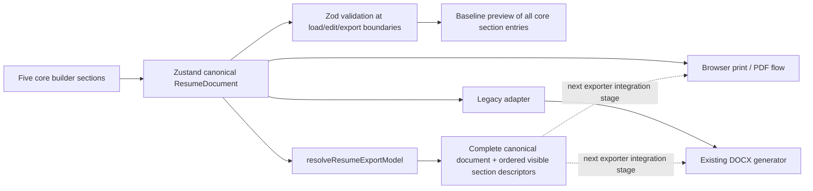
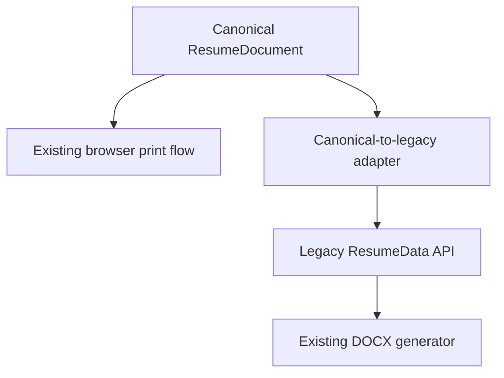

# Architecture Specification

## 1. System Overview
The Professional Resume & CV Generator is an online-only, client-side web application built with Next.js (App Router), TypeScript, Tailwind CSS, shadcn/ui, and Zustand.

The core principle is **zero-retention, privacy-first client-side document authoring**:
- No user accounts or authentication.
- No remote database or cloud persistence.
- No AI APIs or paid third-party dependencies.
- No offline caching or service worker persistence.
- PDF output through the existing browser print flow; typography and pagination still need refinement.
- Client-side Microsoft Word (.docx) generation using `docx`; full canonical-section coverage and professional layout quality are still incomplete.

---

## 2. Feature-Oriented Directory Architecture

The project strictly follows the feature-oriented structure outlined in `AGENTS.md`:

```text
cvmaker/
├── app/                        # Next.js App Router routes and pages
│   ├── layout.tsx              # Root HTML/body shell and global font/theme providers
│   ├── page.tsx                # Public homepage with hero, features, FAQ, CTA
│   ├── builder/                # Interactive resume builder & live preview workspace
│   │   └── page.tsx
│   ├── templates/              # Public template gallery and showcase
│   │   └── page.tsx
│   ├── privacy/                # Privacy policy (essential for AdSense & compliance)
│   ├── terms/                  # Terms of service
│   ├── about/                  # About page
│   ├── contact/                # Contact information
│   ├── sitemap.ts              # Dynamic sitemap generator
│   └── robots.ts               # Robots.txt generator
├── components/                 # Shared UI components
│   ├── ui/                     # Primitives (shadcn/ui based on Radix / Tailwind)
│   ├── layout/                 # Global header, footer, navigation bars
│   └── ads/                    # Isolated AdSense placeholder slots (policy-compliant)
├── features/                   # Core business logic domains
│   ├── templates/              # Template catalog, template registry, metadata
│   │   ├── registry.ts         # Catalog of 10 template entries, without distinct renderers for each
│   │   └── types.ts            # Template definition and configuration contracts
│   ├── resume-editor/          # Core editor fields and five-section builder workspace
│   ├── resume-preview/         # Planned reusable preview, zoom and pagination components
│   ├── pdf-export/             # PDF generation utilities, print stylesheets, triggers
│   │   └── downloadPdf.ts      # Native vector browser print trigger
│   ├── docx-export/            # Word document (.docx) generation
│   │   ├── generateDocx.ts     # Universal OpenXML document generator (client-side)
│   │   └── downloadDocx.ts     # Client-side blob downloader
│   ├── export/                 # Format comparison dialogs & utilities
│   │   └── FormatComparisonModal.tsx
│   └── internationalization/   # Multilingual & RTL typography support
│       ├── config.ts           # Supported locales: EN, UR, AR, FR, ES
│       ├── dictionaries/       # Interface strings
│       └── store.ts            # Persistent locale & direction store
├── hooks/                      # Generic cross-cutting React hooks
├── lib/                        # Utility functions, helpers, class merging
├── schemas/                    # Zod validation schemas for resume data model
├── stores/                     # Zustand stores for in-memory resume data & UI settings
├── styles/                     # Global styles, Tailwind base, and print media rules
├── types/                      # Universal TypeScript types and data models
│   └── resume.ts               # Universal resume data contracts
├── public/                     # Static assets, fonts, template preview thumbnails
├── tests/                      # Automated tests (unit, form validation, template rendering)
└── docs/                       # Project architecture, design, and progress documentation
```

---

## 3. Current Data Flow and State Management



The builder exposes personal information, multiple experience entries and achievements, education, skills, and projects. Experience, education, and project entries can be reordered by stable ID. The preview displays all entries from those five core sections, but remains a single baseline layout. Store support for other canonical sections exists; their editor controls and a final template renderer are future work. Resume data remains in browser memory and is not persisted. The interface language store is separate from the resume document's language and direction settings; the preview applies the document's language and direction.

## 4. Export-Neutral Data Resolution

`features/export/resolveResumeExport.ts` accepts the canonical `ResumeDocument` and returns a `ResumeExportModel` containing that complete document plus its ordered, visible, non-empty section descriptors. The document remains the source of truth for every field, including empty sections, optional values, stable IDs, and the full design configuration. The ordered descriptor list references canonical entries without sorting or rewriting them.

The resolver applies `design.sectionOrder`; unmentioned standard sections are appended in schema order. The `customSections` order token expands custom sections in their stored order, and custom sections can also be placed individually by canonical ID. Their resolved IDs are namespaced as `custom:<id>` to avoid collisions with standard section IDs. A hidden or empty section is omitted from the descriptor list, but its canonical data remains in `model.document`.

This is the shared data boundary for future PDF and DOCX migration. In this stage, the existing PDF path still prints the builder preview and the existing DOCX path still converts through `lib/legacyResumeAdapter.ts`; neither consumes `model.sections` yet. That compatibility boundary is explicit so the resolver does not imply output completeness before both renderers are migrated.

---

## 5. Existing Export Paths and Compatibility Boundary

The project has two client-side export paths, but they do not yet share a fully migrated renderer/export model:



The builder validates canonical data before calling either export path. PDF generation remains unchanged and uses its existing browser print behavior. `lib/legacyResumeAdapter.ts` maps currently supported canonical fields into `types/resume.ts` for the unchanged DOCX generator. That legacy type has no fields for awards, volunteering, publications, interests, or custom sections; those values are retained by the store but are not exported by the current DOCX path. The adapter should be retired only after the exporter is migrated to the canonical model.

### Known Export Limitations:
- **PDF (.pdf)**:
  - Uses existing browser print functionality; typography, pagination, and cross-browser output still require improvement and visual verification.
- **Microsoft Word (.docx)**:
  - Generated by the existing legacy `ResumeData` generator and remains editable, but is not yet guaranteed to meet professional Word layout expectations or support all canonical sections.
  - RTL and cross-suite rendering need direct output verification before being considered complete.
