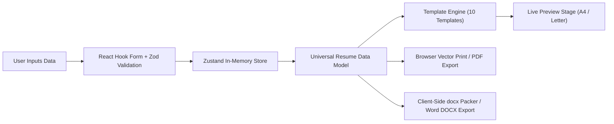
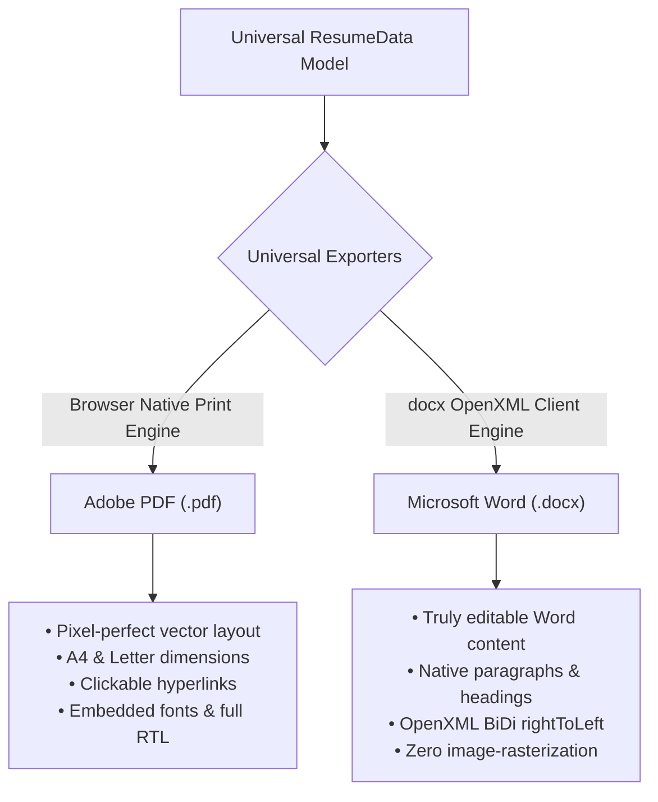

# Architecture Specification

## 1. System Overview
The Professional Resume & CV Generator is an online-only, client-side web application built with Next.js (App Router), TypeScript, Tailwind CSS, shadcn/ui, and Zustand.

The core principle is **zero-retention, privacy-first client-side document authoring**:
- No user accounts or authentication.
- No remote database or cloud persistence.
- No AI APIs or paid third-party dependencies.
- No offline caching or service worker persistence.
- High-fidelity PDF generation via browser-native print standards and vector-accurate rendering.
- Genuinely editable Microsoft Word (.docx) generation client-side using `docx`.

---

## 2. Feature-Oriented Directory Architecture

The project strictly follows the feature-oriented structure outlined in `AGENTS.md`:

```text
cvmaker/
├── app/                        # Next.js App Router routes and pages
│   ├── layout.tsx              # Root HTML/body shell and global font/theme providers
│   ├── page.tsx                # Public homepage with hero, features, FAQ, CTA
│   ├── builder/                # Interactive resume builder & live preview workspace
│   │   └── page.tsx
│   ├── templates/              # Public template gallery and showcase
│   │   └── page.tsx
│   ├── privacy/                # Privacy policy (essential for AdSense & compliance)
│   ├── terms/                  # Terms of service
│   ├── about/                  # About page
│   ├── contact/                # Contact information
│   ├── sitemap.ts              # Dynamic sitemap generator
│   └── robots.ts               # Robots.txt generator
├── components/                 # Shared UI components
│   ├── ui/                     # Primitives (shadcn/ui based on Radix / Tailwind)
│   ├── layout/                 # Global header, footer, navigation bars
│   └── ads/                    # Isolated AdSense placeholder slots (policy-compliant)
├── features/                   # Core business logic domains
│   ├── templates/              # Template catalog, template registry, metadata
│   │   ├── registry.ts         # Index of the 10 professional resume templates
│   │   └── types.ts            # Template definition and configuration contracts
│   ├── resume-editor/          # Dynamic form sections (React Hook Form + Zod)
│   ├── resume-preview/         # Live preview stage, zoom, page simulation, pagination
│   ├── pdf-export/             # PDF generation utilities, print stylesheets, triggers
│   │   └── downloadPdf.ts      # Native vector browser print trigger
│   ├── docx-export/            # Word document (.docx) generation
│   │   ├── generateDocx.ts     # Universal OpenXML document generator (client-side)
│   │   └── downloadDocx.ts     # Client-side blob downloader
│   ├── export/                 # Format comparison dialogs & utilities
│   │   └── FormatComparisonModal.tsx
│   └── internationalization/   # Multilingual & RTL typography support
│       ├── config.ts           # Supported locales: EN, UR, AR, FR, ES
│       ├── dictionaries/       # Interface strings
│       └── store.ts            # Persistent locale & direction store
├── hooks/                      # Generic cross-cutting React hooks
├── lib/                        # Utility functions, helpers, class merging
├── schemas/                    # Zod validation schemas for resume data model
├── stores/                     # Zustand stores for in-memory resume data & UI settings
├── styles/                     # Global styles, Tailwind base, and print media rules
├── types/                      # Universal TypeScript types and data models
│   └── resume.ts               # Universal resume data contracts
├── public/                     # Static assets, fonts, template preview thumbnails
├── tests/                      # Automated tests (unit, form validation, template rendering)
└── docs/                       # Project architecture, design, and progress documentation
```

---

## 3. Data Flow and State Management



---

## 4. Universal Dual Export Architecture (PDF + DOCX)

The system supports two complementary document export formats, both generated 100% client-side without external APIs:



### Template-Independent Architecture:
Adding new templates does **not** require writing individual export modules:
1. Every template defines an `exportStyles` descriptor (primary color hex, secondary color hex, typography stack, header alignment, border rules).
2. The universal DOCX generator ([`generateResumeDocx`](file:///d:/Projects%20Antigravity/cvmaker/features/docx-export/generateDocx.ts)) consumes `(resumeData, template)` and renders native Word OpenXML paragraphs, headings, bullet lists, and borders dynamically.
3. The universal PDF exporter consumes the responsive template component and applies standardized CSS `@media print` rules.

### Formatting Characteristics & Differences:
- **PDF (.pdf)**:
  - Fixed-layout vector document.
  - Identical visual appearance across Windows, macOS, Linux, iOS, and Android.
  - Preserves exact graphic columns, sidebar backgrounds, and millimeter-scale margins.
  - Recommended for direct job submissions and automated ATS portals.
- **Microsoft Word (.docx)**:
  - Reflowable, semantic document composed of genuine text, tables, and bullet points.
  - Fully editable in Microsoft Word, Google Docs, Apple Pages, and LibreOffice.
  - Reflow adaptation: Complex multi-column web elements map into cleanly structured sequential sections with horizontal rules, preventing floating text-box overlap or Word rendering anomalies.
  - Full RTL support with `bidirectional: true` and `rightToLeft: true` runs for Urdu and Arabic.
