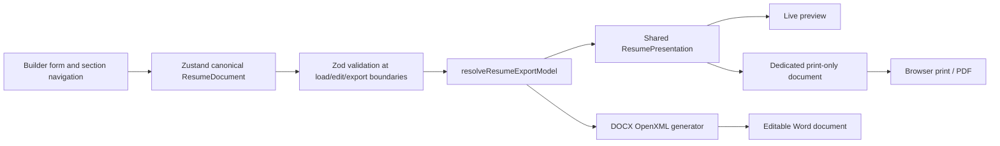
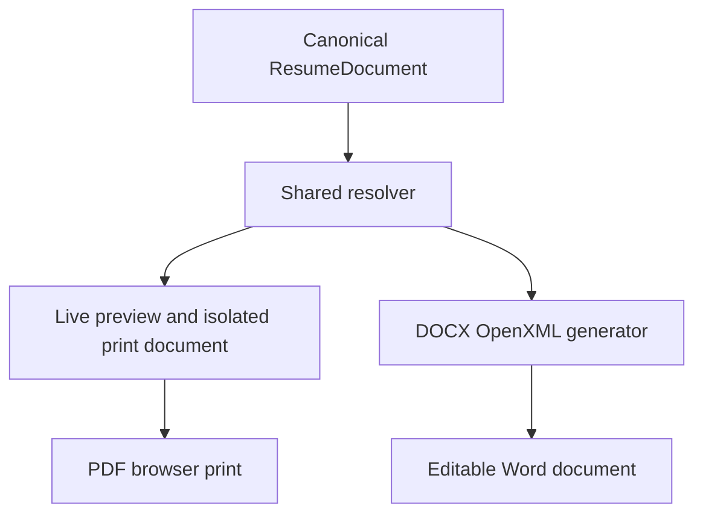

# Architecture Specification

## 1. System Overview
The Professional Resume & CV Generator is an online-only, client-side web application built with Next.js (App Router), TypeScript, Tailwind CSS, shadcn/ui, and Zustand.

The core principle is **zero-retention, privacy-first client-side document authoring**:
- No user accounts or authentication.
- No remote database or cloud persistence.
- No AI APIs or paid third-party dependencies.
- No offline caching or service worker persistence.
- PDF output through a dedicated browser print document rendered by the shared resume presentation component.
- Client-side Microsoft Word (.docx) generation using `docx`; full canonical-section coverage and professional layout quality are still incomplete.

---

## 2. Feature-Oriented Directory Architecture

The project strictly follows the feature-oriented structure outlined in `AGENTS.md`:

```text
cvmaker/
├── app/                        # Next.js App Router routes and pages
│   ├── layout.tsx              # Root HTML/body shell and global font/theme providers
│   ├── page.tsx                # Public homepage with hero, features, FAQ, CTA
│   ├── builder/                # Interactive resume builder & live preview workspace
│   │   └── page.tsx
│   ├── templates/              # Public template gallery and showcase
│   │   └── page.tsx
│   ├── privacy/                # Privacy policy (essential for AdSense & compliance)
│   ├── terms/                  # Terms of service
│   ├── about/                  # About page
│   ├── contact/                # Contact information
│   ├── sitemap.ts              # Dynamic sitemap generator
│   └── robots.ts               # Robots.txt generator
├── components/                 # Shared UI components
│   ├── ui/                     # Primitives (shadcn/ui based on Radix / Tailwind)
│   ├── layout/                 # Global header, footer, navigation bars
│   └── ads/                    # Isolated AdSense placeholder slots (policy-compliant)
├── features/                   # Core business logic domains
│   ├── templates/              # Template catalog, template registry, metadata
│   │   ├── registry.ts         # Catalog of 10 template entries, without distinct renderers for each
│   │   └── types.ts            # Template definition and configuration contracts
│   ├── resume-editor/          # Core editor fields and five-section builder workspace
│   ├── resume-preview/         # Shared canonical preview / print presentation
│   │   └── ResumePresentation.tsx
│   ├── pdf-export/             # PDF page geometry and isolated browser print trigger
│   │   ├── downloadPdf.ts      # Prints the dedicated resume document root
│   │   └── printLayout.ts      # A4 and Letter page rules
│   ├── docx-export/            # Word document (.docx) generation
│   │   ├── generateDocx.ts     # Editable OpenXML generator from resolved canonical content
│   │   └── downloadDocx.ts     # Client-side blob downloader
│   ├── export/                 # Format comparison dialogs & utilities
│   │   └── FormatComparisonModal.tsx
│   └── internationalization/   # Multilingual & RTL typography support
│       ├── config.ts           # Supported locales: EN, UR, AR, FR, ES
│       ├── dictionaries/       # Interface strings
│       └── store.ts            # Persistent locale & direction store
├── hooks/                      # Generic cross-cutting React hooks
├── lib/                        # Utility functions, helpers, class merging
├── schemas/                    # Zod validation schemas for resume data model
├── stores/                     # Zustand stores for in-memory resume data & UI settings
├── styles/                     # Global styles, Tailwind base, and print media rules
├── types/                      # Universal TypeScript types and data models
│   └── resume.ts               # Universal resume data contracts
├── public/                     # Static assets, fonts, template preview thumbnails
├── tests/                      # Automated tests (unit, form validation, template rendering)
└── docs/                       # Project architecture, design, and progress documentation
```

---

## 3. Current Data Flow and State Management



The builder exposes personal information, multiple experience entries and achievements, education, skills, and projects. Experience, education, and project entries can be reordered by stable ID. The preview displays all entries from those five core sections, but remains a single baseline layout. Store support for other canonical sections exists; their editor controls and a final template renderer are future work. Resume data remains in browser memory and is not persisted. The interface language store is separate from the resume document's language and direction settings; the preview applies the document's language and direction.

## 4. Shared Resume Presentation and PDF Output

`features/export/resolveResumeExport.ts` accepts the canonical `ResumeDocument` and returns its complete content/design plus an ordered list of visible, non-empty canonical sections. Standard sections follow `design.sectionOrder`; omitted order tokens are appended in schema order. Custom sections retain their entry order and use `custom:<id>` resolved IDs. Hidden and empty section data remains in the document but is not presented.

`features/resume-preview/ResumePresentation.tsx` consumes that resolved model and renders personal/contact information and every supported canonical section. It applies language, direction, selected accent/font/font sizes, paper size, and configured margins. The live preview and dedicated `#resume-pdf-document` use this same component; the print root is separate from the editor and does not depend on the active section or mobile preview toggle.

`features/pdf-export/downloadPdf.ts` snapshots the validated current Zustand document, resolves it, waits for the dedicated print root to update, then invokes browser printing. It injects an exact A4 (`210 × 297 mm`) or US Letter (`215.9 × 279.4 mm`) `@page` rule. Print CSS hides the app shell/editor and prints only the dedicated resume document; its own contact header remains visible. Entry and heading break rules support multi-page output without shrinking content to one page.

The live preview and print document use matching resolved section IDs and resume text. Browser rendering can still vary slightly by font availability and print implementation; English, Arabic/RTL, photo, comprehensive, long-document, A4, and Letter PDFs were rendered and visually inspected during milestone verification.

The resolver remains format-neutral; it performs ordering, visibility, and empty-section filtering only. It does not format dates or create PDF- or Word-specific output.

---

## 5. DOCX Export and Compatibility Boundary

DOCX and PDF now start from the same canonical resolver output. PDF uses the shared HTML/CSS presentation; DOCX maps that same ordered section sequence and design configuration to editable Word paragraphs, lists, hyperlinks, an optional embedded image, and page geometry:



The builder validates the current Zustand document, resolves order and visibility, and passes the resulting `ResumeExportModel` to both export paths. The DOCX generator validates the canonical document again at its boundary and re-resolves it, preventing mismatched section lists from silently dropping content. It emits all supported standard sections and custom entries as native Word content. Contact and canonical URLs become editable hyperlinks. PNG/JPEG photo bytes are embedded; browser-supported WebP images are converted to PNG before embedding. Missing or inaccessible photo assets do not block export. The legacy `lib/legacyResumeAdapter.ts` remains in the repository for compatibility, but it is no longer used by the builder's primary export button.

DOCX page dimensions are explicitly set in twips from the selected A4 or US Letter size, rounded to the nearest twip; all four configured millimeter margins are applied. Font family, point sizes, accent color, resume language and text direction are read from canonical design settings. Semantic Word heading styles, native list numbering, keep-with-next heading behavior, and tab stops for dates support editable text and multi-page flow.

Automated tests inspect the generated OOXML for content, section ordering/visibility, links, RTL properties, photo relationships/media bytes, page size, margins, and long-content retention. Visual page rendering still depends on an available Word-compatible renderer; do not infer cross-application layout fidelity from XML tests alone.

### Known Export Limitations:
- **PDF (.pdf)**:
  - Prints only the shared dedicated resume document. A4, Letter, English, Arabic, photo, comprehensive-section, and long-document outputs have been exercised locally. Browser/font differences still warrant broader cross-browser verification.
- **Microsoft Word (.docx)**:
  - Uses the canonical resolved model and keeps resume text editable; all visible canonical sections and links are covered by generated OOXML tests.
  - A4/Letter dimensions and configured margins are verified from `word/document.xml`; PNG photo embedding is verified from the media part and relationship.
  - Word/LibreOffice visual rendering and Arabic/Urdu appearance remain unverified in this environment because no compatible desktop renderer is installed. Font substitution and cross-suite layout still need verification.
